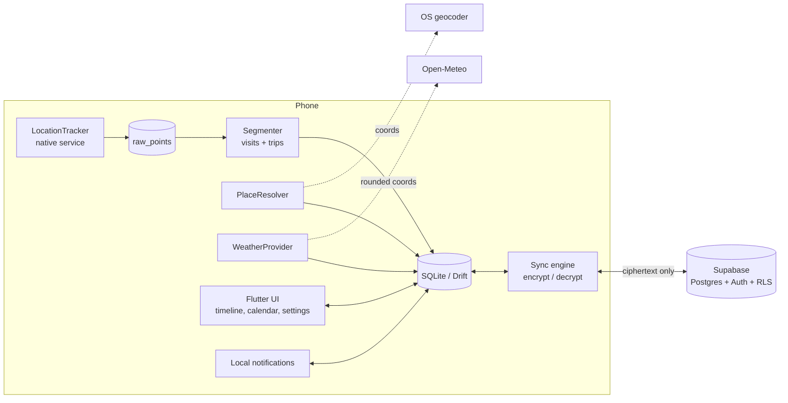

# Technical Requirements: Project B

## Stack
| Layer | Choice | Why |
|---|---|---|
| App framework | Flutter (Dart), stable channel | One codebase for Android + iOS, strong UI control, gentle for a Python developer |
| State management | Riverpod | Testable, compile-time safe, little boilerplate |
| Local database | SQLite via Drift | Typed queries, migrations, good for time-series-ish data. Optional SQLCipher for at-rest encryption |
| Background location | Native foreground service (Android) + Core Location (iOS) through a plugin, behind a `LocationTracker` interface | Pure Dart background execution is unreliable for continuous location (research doc section 3) |
| Initial plugin candidate | `flutter_background_geolocation` | Motion-aware, battery-conscious. Free in debug builds; paid licence for Android release builds |
| Fallback plugin | A free native-service plugin (e.g. `smart_location`), tested head-to-head | Avoids lock-in to a paid licence; needs hands-on validation |
| Maps | `flutter_map` with an OSM-based tile provider (swap to MapLibre if needed) | No API key or billing for personal use |
| Reverse geocoding | `geocoding` package (platform geocoders), behind a `PlaceResolver` interface | Free, calls the OS geocoder; swappable for Google Places later |
| Weather | Open-Meteo, behind a `WeatherProvider` interface | No key, simple JSON |
| Notifications | `flutter_local_notifications` | Local scheduled reminders, no server |
| Cloud backend | Supabase (Postgres, Auth, RLS) | Free tier fits; self-hostable; we do our own sync protocol |
| Auth | Supabase email OTP | No Sign in with Apple obligation in v1 |
| Crypto | libsodium bindings (e.g. `sodium_libs`) or Dart `cryptography` | Vetted primitives only; Argon2id + XChaCha20-Poly1305 |
| CI | GitHub Actions (analyze, test, build) | Free for small projects |

Decision log: every "behind an interface" item exists so a paid or fragile dependency can be replaced without touching UI code.

## Architecture
On-device first. The phone is the source of truth. The cloud is an encrypted backup and a way to merge devices.

### Layers inside the app
1. **Tracking layer** (native): collects location samples with timestamps, accuracy and speed; writes `raw_points` even when the Flutter UI is not running.
2. **Domain layer** (Dart): segmentation, place matching, retention, sync.
3. **Data layer**: Drift DAOs, repositories.
4. **UI layer**: screens in doc 03, theme in doc 04.

### Segmentation approach (v1)
- **Visit:** consecutive points within a 100 m radius for at least 10 minutes. Parameters are settings constants, tunable.
- **Trip:** points between two visits; simplified (e.g. Ramer–Douglas–Peucker) for storage and drawing.
- Runs incrementally when new points arrive and again at end of day to fix boundaries.
- Gaps longer than 30 minutes with no points are recorded as a `gap`, shown honestly in the timeline rather than guessed.

### Sync approach (v1)
- Unit of sync = one record (visit, trip, place, event, reminder) as an encrypted blob with metadata `kind`, `day`, `version`, `updated_at`, `deleted`.
- Push: send records changed since last push. Pull: fetch records with `updated_at` after the stored cursor.
- Conflict rule: last write wins per record by `updated_at`; deletes are tombstones. Acceptable because edits are rare and mostly on one device at a time.
- Raw points are **not** synced (large, low value); only derived visits/trips are.

## Third-party services and integrations
| Service | Purpose | Notes (keys, webhooks, limits) |
|---|---|---|
| Supabase | Auth, encrypted sync storage | Anon key is public by design; protection comes from RLS. Free projects pause after a week of inactivity and are limited to two active projects (research doc section 5) |
| Open-Meteo | Weather and forecast | No key; verify current free-use terms before any public release |
| OS geocoder (Android Geocoder / iOS CLGeocoder) | Place names | May call the vendor's backend; rate limited by the OS; queue and retry |
| Map tile provider | Map background | Public OSM tile server has a usage policy; use a proper provider for release |
| Google Play Console | Distribution + background location declaration | Required before release (research doc section 4) |
| Apple Developer Program | TestFlight / App Store | Paid, yearly; buy when store prep starts |

## Non-functional requirements
**Privacy and security**
- Location data never leaves the device unencrypted. External calls leak approximate location, so: weather requests use coordinates rounded to ~1 km; place lookups use the OS geocoder at full precision, which may contact the platform vendor's service (disclosed in settings, with a switch to turn auto-labelling off).
- Local DB: encrypted at rest with SQLCipher if the measured performance cost is acceptable; otherwise rely on OS file-based encryption and document it.
- Encryption: Argon2id for passphrase to key; random data key wrapped by the passphrase key and by a recovery key; XChaCha20-Poly1305 per record with unique nonce.
- No analytics SDKs, no ad SDKs, no third-party crash reporter that uploads location data. If crash reporting is added, it must scrub coordinates.
- Secrets: no service-role key ever ships in the app.

**Performance and battery**
- Balanced mode target: under 5% extra battery per day (measured on the test Samsung).
- Timeline day view renders in under 500 ms for a day with 30 visits and 20 trips.
- Raw point writes are batched (e.g. flush every 20 points or 60 s).

**Reliability**
- Tracking survives app kill and reboot while enabled (Android boot receiver; iOS significant-change relaunch).
- Gap detection and in-app health check ("tracking last confirmed at 14:32").

**Storage**
- Raw points retained 30 days by default, configurable; visits and trips kept until deleted.
- Rough budget: under 50 MB per year for derived data in normal use (verify during Phase 4).

**Accessibility and devices**
- Android 8.0+ (API 26+) and iOS 15+ as starting minimums; confirm against plugin requirements when installed.
- Dynamic text sizes, screen reader labels, 48 dp touch targets (doc 04).

**Logging and monitoring**
- Local rotating debug log, viewable and exportable by the user. No remote logging in v1.

## Environments and configuration
| Environment | Purpose |
|---|---|
| dev | Local debug builds; Supabase dev project |
| prod | Release builds; separate Supabase project |

Environment variables / build-time defines (names only): `SUPABASE_URL`, `SUPABASE_ANON_KEY`, `WEATHER_BASE_URL`, `TILE_URL_TEMPLATE`, `BG_GEOLOCATION_LICENSE_KEY` (release only). Provided via `--dart-define-from-file`; the file is gitignored. Never commit keys.

Platform setup to track:
- Android manifest: `ACCESS_FINE_LOCATION`, `ACCESS_COARSE_LOCATION`, `ACCESS_BACKGROUND_LOCATION`, `FOREGROUND_SERVICE`, `FOREGROUND_SERVICE_LOCATION`, `POST_NOTIFICATIONS`, `RECEIVE_BOOT_COMPLETED`.
- iOS Info.plist: usage descriptions for When In Use and Always; Background Modes → Location updates.

## Testing approach
- **Unit:** segmenter (synthetic point streams for visit, trip, gap, jitter), retention, crypto round-trips, sync merge/conflict logic.
- **Integration:** Drift migrations, repository tests with an in-memory DB, sync engine against a local Supabase instance.
- **Widget:** timeline day view, permission onboarding states, theme variants.
- **Manual device tests (required, cannot be automated well):** a week of real use on the Samsung with screen off; reboot test; airplane-mode test; low-battery mode switch; same on a real iPhone when available.
- **Battery test log:** record battery % at fixed times per mode in the progress log of doc 06.

## Risks and open questions
Risks
1. Background tracking reliability on Samsung One UI (aggressive battery management).
2. Play Store background location approval (declaration, video, disclosure).
3. Plugin licence cost or abandonment.
4. iOS validation limited without a physical iPhone.
5. E2EE UX: passphrase loss is unrecoverable by design.

Open questions
1. Is SQLCipher worth the build complexity for v1, or is OS-level encryption enough?
2. Free tile provider choice for release.
3. Minimum OS versions after checking chosen plugins.
4. Whether to keep raw points off sync forever, or add an opt-in "full history" sync later.
