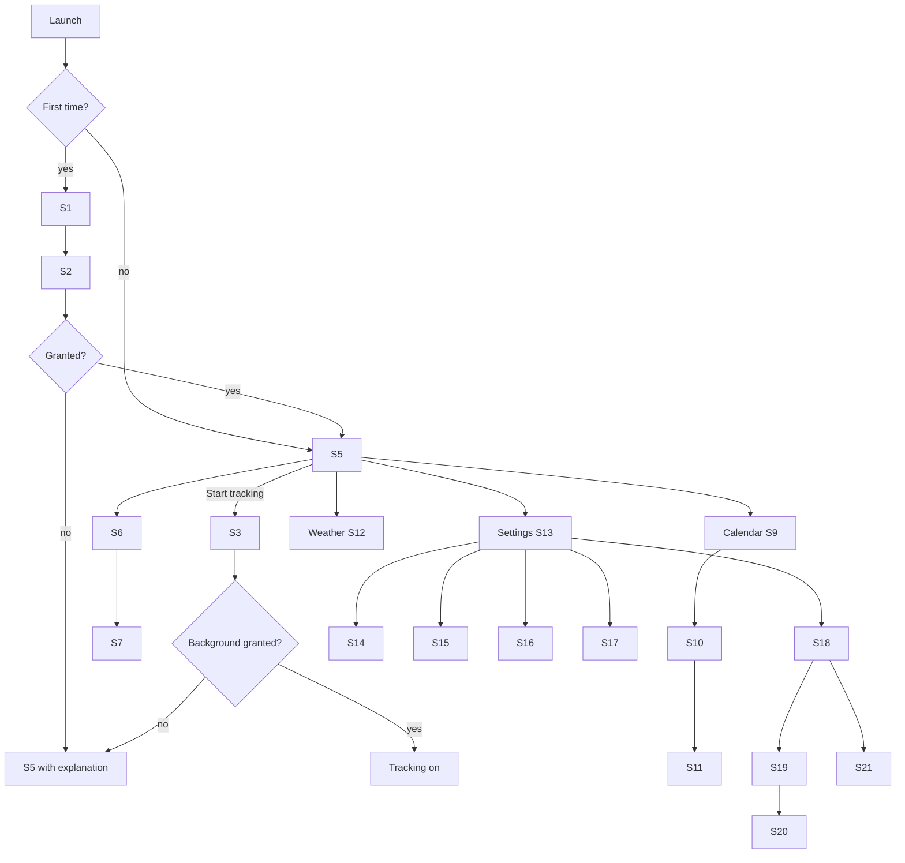

# App Flow: Project B

Navigation: bottom tab bar with four tabs (Timeline, Calendar, Weather, Settings). Onboarding and sync setup are modal flows.

## Screen inventory
| ID | Screen | Route | Who can see it | Purpose | Features |
|---|---|---|---|---|---|
| S1 | Welcome / disclosure | `/onboarding/welcome` | First launch | Explain what is recorded and why | F1 |
| S2 | Permission: foreground location | `/onboarding/location` | First launch | Request While-in-use location | F1 |
| S3 | Permission: background location | `/onboarding/background` | When user enables tracking | Prominent disclosure then Always/background request | F1, F2 |
| S4 | Notification permission | `/onboarding/notifications` | First launch / on first reminder | Request notification permission | F6 |
| S5 | Timeline (today) | `/timeline` | Owner | Live view of today: current state, visits, trips | F2, F4 |
| S6 | Day detail | `/timeline/:date` | Owner | Map + list of visits and trips for a day | F4, F5 |
| S7 | Visit detail | `/visit/:id` | Owner | Rename place, edit times, delete | F4, F5 |
| S8 | Trip detail | `/trip/:id` | Owner | Route map, distance, duration | F4 |
| S9 | Calendar (month) | `/calendar` | Owner | Month grid with markers for events and visits | F6 |
| S10 | Calendar day | `/calendar/:date` | Owner | Agenda: events + timeline entries + weather chip | F6, F7 |
| S11 | Event editor | `/event/:id?` | Owner | Create/edit event and reminder | F6 |
| S12 | Weather | `/weather` | Owner | Current + forecast | F7 |
| S13 | Settings | `/settings` | Owner | Hub for all settings | all |
| S14 | Tracking settings | `/settings/tracking` | Owner | Mode, auto-saver level, retention, tracking health | F2, F3, F8 |
| S15 | Places | `/settings/places` | Owner | Saved/renamed places, auto-label switch | F5 |
| S16 | Appearance | `/settings/appearance` | Owner | Light / dark / system | F8 |
| S17 | Data and export | `/settings/data` | Owner | Export, delete all | F8 |
| S18 | Sync | `/settings/sync` | Owner | Status, enable/disable, delete cloud data | F9 |
| S19 | Sync setup: email | `/sync/email` | Owner enabling sync | Enter email, receive OTP | F9 |
| S20 | Sync setup: passphrase + recovery key | `/sync/passphrase` | Owner enabling sync | Create passphrase, show and confirm recovery key | F9 |
| S21 | Restore on new device | `/sync/restore` | Owner on new phone | Sign in, enter passphrase or recovery key, pull data | F9 |
| S22 | Keep-alive guide | `/help/keep-alive` | Owner (esp. Samsung) | Steps to exempt app from battery optimisation | F2 |

## Primary flows

### Flow A: First launch and start tracking (F1, F2)
1. User opens the app for the first time → S1 explains in plain language: what is recorded, that it continues when the app is closed, that data stays on the phone, how to delete it.
2. User taps Continue → S2 requests foreground location.
3. If granted, user lands on S5 with a "Start tracking" card. If denied, S5 shows an explanation and an "Open settings" button; no crash.
4. User taps Start tracking → S3 shows the prominent disclosure, then the system background-location prompt (Android: separate step after foreground; iOS: Always upgrade).
5. If granted, tracking starts; S5 shows "Tracking on · Balanced". Android shows the foreground-service notification.
6. On Samsung (or any device where the OS reports battery optimisation is active) → S22 is offered once, non-blocking.
7. On error or denial: tracking stays off, S5 shows the reason and a retry.

### Flow B: Review a day (F4, F5)
1. User opens Timeline tab → S5 (today), or picks a date → S6.
2. S6 shows a map with the day's route and a list: Visit, Trip, Visit, Trip…
3. User taps a visit → S7. They rename it (Java House → "Coffee with Amani"), adjust times, or delete.
4. On rename, app asks: "Use this name for visits near here?" Yes saves a place (S15).
5. Gaps in tracking appear as grey "No data" blocks with a likely reason if known (paused, permission revoked, phone off).
6. Offline: all of the above works; unlabelled visits get names when the phone is online again.

### Flow C: Add an event with a reminder (F6)
1. User opens Calendar → S9, taps a date → S10.
2. Taps "+" → S11, enters title, start/end, optional location and notes, picks reminder time (e.g. 30 minutes before).
3. Save → event appears in the agenda; local notification scheduled (needs S4 permission; if not granted, the app asks once and otherwise saves the event without a notification and says so).
4. If the event has a location and a forecast exists, S10 shows a weather chip for that time (F7).
5. Edit/delete from S11; deleting cancels the notification.

### Flow D: Check weather (F7)
1. User opens Weather → S12; app uses the last known location rounded to ~1 km.
2. Shows current conditions and a multi-day forecast.
3. Offline: shows the cached result with a "Last updated 3 h ago" label.

### Flow E: Change battery mode (F3)
1. User opens Settings → Tracking (S14).
2. Picks High precision / Balanced / Battery saver; a one-line description explains the trade-off.
3. Toggles "Switch to Battery saver at 15%" and sets the level.
4. Tracker reconfigures immediately without stopping; S5 shows the new mode.

### Flow F: Turn on cloud sync (F9)
1. Settings → Sync (S18) → "Turn on sync".
2. S19: enter email, receive a one-time code, enter code.
3. S20: create passphrase; app generates a recovery key and displays it; user must confirm they saved it (re-enter two words from it).
4. App warns: losing both passphrase and recovery key means cloud data cannot be recovered.
5. Initial upload runs in the background; S18 shows progress and "Last synced".
6. On error (no network, invalid code): clear message, retry; local data is never affected.

### Flow G: Restore on a new phone (F9)
1. Install app → onboarding as in Flow A.
2. Settings → Sync → "Restore from cloud" → S21: sign in with email OTP.
3. Enter passphrase or recovery key; app downloads and decrypts records.
4. Wrong passphrase: error after verifying against the wrapped key; no data written.
5. Timeline fills in; raw points are not restored (by design).

### Flow H: Export or delete (F8)
1. Settings → Data (S17).
2. Export: choose JSON (all) or GPX (routes) → system share sheet.
3. Delete all: confirmation with typed word "DELETE" → local data wiped; if sync is on, option to also delete cloud data.

## Navigation structure
- Bottom tabs: Timeline (S5), Calendar (S9), Weather (S12), Settings (S13).
- S6 reached from S5 date picker or from S10 timeline entries; S7/S8 from lists.
- Onboarding (S1–S4) is a one-time modal stack; S3 re-appears any time the user turns tracking on without background permission.
- Notification tap deep-links to S11 (the event).
- Persistent tracking-state chip at the top of S5 and in Settings; tapping opens S14.

## States and edge cases
| Situation | Behaviour |
|---|---|
| Foreground permission denied | App works as a calendar/weather app; Timeline tab shows an explanation and Open Settings button |
| Background permission denied or revoked later | Tracking marked "Off: permission needed"; banner on S5; day gaps labelled |
| Location services turned off | Banner with link to system settings |
| Android: app battery-optimised / killed | Gap logged; S22 offered; health card "last point received 2 h ago" |
| Low battery | If auto-saver rule is on, switch mode and show a one-time snackbar |
| Offline | Everything local works; weather shows cache; labelling and sync queue |
| Empty states | No data yet: "Nothing recorded for this day"; no events: "No events. Tap + to add one." |
| Loading | Skeleton rows for timeline and forecast, never a blank screen |
| Reboot | Tracking resumes automatically if it was on (notification reappears on Android) |
| Passphrase forgotten | Offer recovery key; otherwise explain data cannot be restored and offer "Start fresh in the cloud" |
| Sync conflict | Last write wins per record; no user prompt in v1 |
| Time zone change / travel | Timestamps stored in UTC with the local offset at capture; days are shown in the offset where each entry happened |
| Storage low | Warn in S17; offer to shorten raw point retention |
