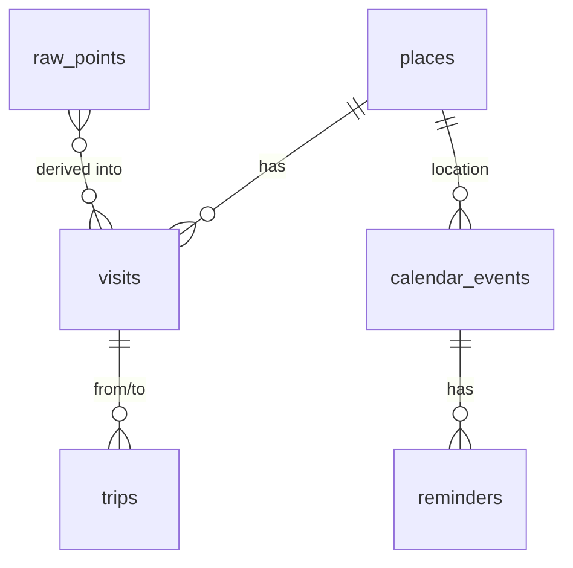
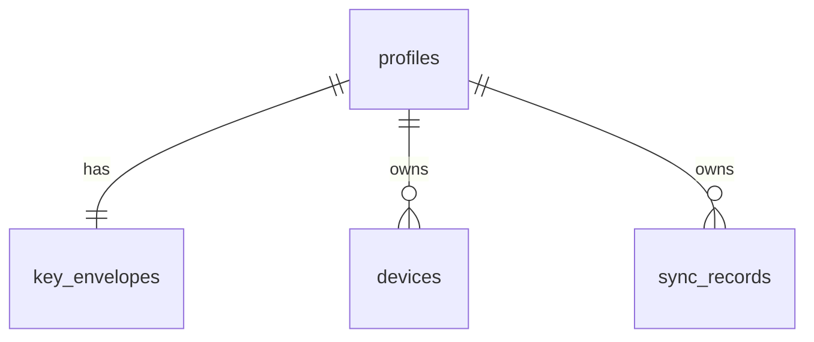

# Backend Schema: Project B

Two data stores:
1. **Local SQLite (Drift)** on every phone. Source of truth. Holds readable data.
2. **Supabase Postgres** (optional). Holds only encrypted blobs plus minimal metadata.

All IDs are UUID v7 (time-sortable) generated on the device so records can be created offline. Timestamps are stored as UTC milliseconds (local) / `timestamptz` (cloud), with a stored UTC offset in minutes where a local day matters.

---

## Part A: Local database (SQLite / Drift)

### raw_points
| Column | Type | Constraints | Notes |
|---|---|---|---|
| id | INTEGER | PK autoincrement | |
| recorded_at | INTEGER | NOT NULL | UTC ms |
| utc_offset_min | INTEGER | NOT NULL | Offset at capture |
| lat | REAL | NOT NULL | |
| lng | REAL | NOT NULL | |
| accuracy_m | REAL | | |
| speed_mps | REAL | | |
| altitude_m | REAL | | |
| activity | TEXT | | still / walking / driving etc. when plugin provides it |
| battery_pct | INTEGER | | Helps battery analysis |
| mode | TEXT | NOT NULL | high / balanced / saver at capture |
| processed | INTEGER | NOT NULL DEFAULT 0 | 1 once segmented |

Indexes: `(recorded_at)`, `(processed, recorded_at)`. Deleted by retention job. **Never synced.**

### places
| Column | Type | Constraints | Notes |
|---|---|---|---|
| id | TEXT | PK | UUID |
| name | TEXT | | User or auto label |
| name_source | TEXT | NOT NULL | `auto` / `user` |
| address | TEXT | | |
| lat | REAL | NOT NULL | Centre |
| lng | REAL | NOT NULL | |
| radius_m | INTEGER | NOT NULL DEFAULT 100 | Matching radius |
| category | TEXT | | Later |
| created_at / updated_at | INTEGER | NOT NULL | |
| deleted | INTEGER | NOT NULL DEFAULT 0 | Tombstone for sync |

Index: `(lat, lng)` (or a bounding-box helper) for nearby matching.

### visits
| Column | Type | Constraints | Notes |
|---|---|---|---|
| id | TEXT | PK | |
| place_id | TEXT | FK → places.id, nullable | Null until labelled |
| start_at / end_at | INTEGER | NOT NULL | UTC ms; `end_at` null while ongoing |
| utc_offset_min | INTEGER | NOT NULL | |
| lat / lng | REAL | NOT NULL | Centroid |
| point_count | INTEGER | | |
| label_state | TEXT | NOT NULL DEFAULT 'pending' | pending / done / failed / disabled |
| user_edited | INTEGER | NOT NULL DEFAULT 0 | Protects edits from re-segmentation |
| created_at / updated_at | INTEGER | NOT NULL | |
| deleted | INTEGER | NOT NULL DEFAULT 0 | |

Indexes: `(start_at)`, `(place_id)`.

### trips
| Column | Type | Constraints | Notes |
|---|---|---|---|
| id | TEXT | PK | |
| from_visit_id / to_visit_id | TEXT | FK → visits.id, nullable | |
| start_at / end_at | INTEGER | NOT NULL | |
| utc_offset_min | INTEGER | NOT NULL | |
| distance_m | REAL | | |
| mode_guess | TEXT | | walk / drive / unknown |
| route | BLOB | | Compressed simplified polyline |
| created_at / updated_at | INTEGER | NOT NULL | |
| deleted | INTEGER | NOT NULL DEFAULT 0 | |

Index: `(start_at)`.

### gaps
| Column | Type | Notes |
|---|---|---|
| id TEXT PK, start_at, end_at | | Derived; recomputed, not synced |
| reason | TEXT | paused / permission / off / unknown |

### calendar_events
| Column | Type | Constraints | Notes |
|---|---|---|---|
| id | TEXT | PK | |
| title | TEXT | NOT NULL | |
| notes | TEXT | | |
| start_at / end_at | INTEGER | NOT NULL | |
| all_day | INTEGER | NOT NULL DEFAULT 0 | |
| utc_offset_min | INTEGER | NOT NULL | |
| place_id | TEXT | FK → places.id | Optional |
| location_text | TEXT | | Free text |
| created_at / updated_at | INTEGER | NOT NULL | |
| deleted | INTEGER | NOT NULL DEFAULT 0 | |

### reminders
| Column | Type | Constraints | Notes |
|---|---|---|---|
| id | TEXT | PK | |
| event_id | TEXT | FK → calendar_events.id | Nullable for standalone reminders |
| fire_at | INTEGER | NOT NULL | UTC ms |
| offset_before_min | INTEGER | | Reminder relative to event |
| notification_id | INTEGER | | OS handle for cancelling |
| status | TEXT | NOT NULL DEFAULT 'scheduled' | scheduled / fired / cancelled |
| created_at / updated_at | INTEGER | NOT NULL | |
| deleted | INTEGER | NOT NULL DEFAULT 0 | |

Later table `geofence_reminders` (place_id, text, trigger enter/exit).

### weather_cache
| Column | Type | Notes |
|---|---|---|
| key | TEXT PK | Rounded lat,lng + date |
| fetched_at | INTEGER | |
| payload | TEXT | JSON from provider |

### settings
Key-value: `tracking_enabled`, `tracking_mode`, `auto_saver_enabled`, `auto_saver_level`, `raw_retention_days`, `auto_label_enabled`, `theme`, `units`, `sync_enabled`.

### sync_state
| Column | Type | Notes |
|---|---|---|
| device_id | TEXT | Generated once per install |
| last_pull_cursor | TEXT | Server `updated_at` / version of last pulled record |
| last_push_at | INTEGER | |
| key_check | TEXT | Small encrypted known value to verify the passphrase |

### sync_outbox
| Column | Type | Notes |
|---|---|---|
| id | INTEGER PK | |
| record_kind | TEXT | place / visit / trip / event / reminder |
| record_id | TEXT | |
| queued_at | INTEGER | |

### Relationships


### Local jobs
| Job | When | Does |
|---|---|---|
| Segmenter | On new points, plus end of day | raw_points → visits / trips / gaps |
| Labeller | After a visit closes, and on connectivity | Resolve place names |
| Retention | Daily | Delete raw_points older than `raw_retention_days` |
| Reminder reschedule | On boot and on app start | Re-register scheduled notifications |
| Sync | On change (debounced), on app start, on connectivity | Push outbox, pull changes |

---

## Part B: Cloud database (Supabase Postgres)

Server never sees plaintext location, titles or notes.

### profiles
| Column | Type | Constraints | Notes |
|---|---|---|---|
| id | uuid | PK, FK → auth.users.id | |
| created_at | timestamptz | default now() | |

### key_envelopes
Holds the wrapped data keys. One row per user.
| Column | Type | Constraints | Notes |
|---|---|---|---|
| user_id | uuid | PK, FK → profiles.id | |
| kdf | text | NOT NULL | e.g. `argon2id` |
| kdf_params | jsonb | NOT NULL | memory, iterations, parallelism |
| salt | bytea | NOT NULL | |
| wrapped_key_passphrase | bytea | NOT NULL | Data key wrapped by passphrase-derived key |
| wrapped_key_recovery | bytea | NOT NULL | Data key wrapped by recovery key |
| key_version | int | NOT NULL DEFAULT 1 | For future rotation |
| updated_at | timestamptz | default now() | |

### devices
| Column | Type | Constraints | Notes |
|---|---|---|---|
| id | uuid | PK | Client `device_id` |
| user_id | uuid | NOT NULL, FK → profiles.id | |
| label | text | | e.g. "Samsung phone" (plain text; user can leave blank) |
| last_seen_at | timestamptz | | |

### sync_records
| Column | Type | Constraints | Notes |
|---|---|---|---|
| id | uuid | PK (with user_id) | Client record id |
| user_id | uuid | NOT NULL, FK → profiles.id | |
| kind | text | NOT NULL | place / visit / trip / event / reminder |
| day | date | | Local day bucket (optional, for partial pulls) |
| payload | bytea | NOT NULL | Ciphertext |
| nonce | bytea | NOT NULL | |
| key_version | int | NOT NULL | |
| schema_version | int | NOT NULL | Payload format |
| deleted | boolean | NOT NULL DEFAULT false | Tombstone (payload may be empty ciphertext) |
| device_id | uuid | | Last writer |
| client_updated_at | timestamptz | NOT NULL | Used for last-write-wins |
| server_seq | bigint | NOT NULL, generated | Monotonic cursor for pulls |

PK `(user_id, id)`. Indexes: `(user_id, server_seq)`, `(user_id, kind, day)`.

### Relationships


### Row Level Security
All four tables: RLS enabled; policy `user_id = auth.uid()` (or `id = auth.uid()` for profiles) for select, insert, update, delete. No service-role key in the client. Payload column is ciphertext, so a policy bug is damaging but not catastrophic; still test RLS with two accounts.

---

## API endpoints
Supabase exposes tables through PostgREST and auth through GoTrue. The client uses the Supabase SDK; paths are listed for clarity. All calls except sign-in require `Authorization: Bearer <access_token>`.

### Auth
| Method | Path | Auth | Description |
|---|---|---|---|
| POST | `/auth/v1/otp` | anon | Send email one-time code |
| POST | `/auth/v1/verify` | anon | Verify code, return session |
| POST | `/auth/v1/token?grant_type=refresh_token` | refresh token | Refresh session |
| POST | `/auth/v1/logout` | user | Sign out this device |

### Key envelope
| Method | Path | Auth | Description |
|---|---|---|---|
| GET | `/rest/v1/key_envelopes?user_id=eq.{uid}` | user | Fetch wrapped keys (restore flow) |
| POST | `/rest/v1/key_envelopes` | user | Create on first sync setup |
| PATCH | `/rest/v1/key_envelopes?user_id=eq.{uid}` | user | Change passphrase (re-wrap) |

### Devices
| Method | Path | Auth | Description |
|---|---|---|---|
| POST | `/rest/v1/devices` (upsert) | user | Register or update this device |
| GET | `/rest/v1/devices` | user | List devices |
| DELETE | `/rest/v1/devices?id=eq.{id}` | user | Remove a device |

### Sync
| Method | Path | Auth | Description |
|---|---|---|---|
| POST | `/rest/v1/rpc/push_records` | user | Upsert a batch of records with last-write-wins |
| GET | `/rest/v1/rpc/pull_records?since={server_seq}&limit=500` | user | Records changed after cursor |
| DELETE | `/rest/v1/rpc/delete_my_cloud_data` | user | Remove all sync_records, key_envelopes, devices |

#### POST /rest/v1/rpc/push_records
Request:
```json
{
  "device_id": "uuid",
  "records": [
    {
      "id": "uuid",
      "kind": "visit",
      "day": "2026-10-22",
      "payload": "base64-ciphertext",
      "nonce": "base64",
      "key_version": 1,
      "schema_version": 1,
      "deleted": false,
      "client_updated_at": "2026-10-22T14:03:11Z"
    }
  ]
}
```
Response 200:
```json
{ "accepted": ["uuid"], "rejected": [{ "id": "uuid", "reason": "stale" }], "max_server_seq": 12345 }
```
Rules: a record is accepted only if `client_updated_at` is newer than the stored one; otherwise `stale` (client should pull). Batch limit 200 records / 1 MB.
Errors: 400 validation, 401 unauthenticated, 413 batch too large, 429 rate limited.

#### GET /rest/v1/rpc/pull_records
Response 200:
```json
{ "records": [ { "id": "uuid", "kind": "visit", "payload": "...", "nonce": "...", "key_version": 1, "schema_version": 1, "deleted": false, "client_updated_at": "...", "server_seq": 12340 } ], "next_since": 12345, "has_more": false }
```
Errors: 401 unauthenticated.

#### DELETE /rest/v1/rpc/delete_my_cloud_data
Response 204. Irreversible; the app confirms first. The user's auth account is deleted separately via a small Edge Function (`delete-account`) that calls the admin API server-side.

## Authentication and authorization
- Email OTP via Supabase Auth; sessions are JWTs refreshed by the SDK; tokens stored in the platform secure store (Keychain / Keystore).
- Authorization is entirely RLS: a user can touch only rows with their own `user_id`.
- The encryption passphrase is **never** sent to the server. Wrong-passphrase detection happens on the device by trying to unwrap the key and checking `key_check`.
- Rate limits: rely on Supabase Auth OTP limits; add a per-user request cap in the RPCs if abuse shows up.

## Webhooks and background jobs
- None in v1.
- Optional later: scheduled Postgres job to purge tombstones older than 90 days; Edge Function for account deletion (v1 requires this one).

## Validation and error format
Server RPCs return errors in one shape:
```json
{ "error": { "code": "stale_record", "message": "Human readable text", "details": {} } }
```
Common codes: `invalid_payload`, `batch_too_large`, `stale_record`, `unauthorized`, `rate_limited`, `key_version_mismatch`.
Client rule: sync errors never change local data; the UI shows "Sync paused: {reason}" with retry.
