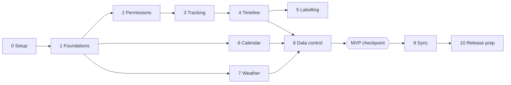

# Implementation Plan: Project B

## Approach
Build order follows risk. The riskiest thing in this app is **reliable background tracking on real phones** (Samsung especially, then iOS), so it gets proven early, before polish or sync. Everything else (UI, calendar, weather, sync) is well-understood and comes after.

Rules for the build:
1. Keep every external dependency behind an interface: `LocationTracker`, `PlaceResolver`, `WeatherProvider`, `SyncBackend`.
2. Local-first: every feature must work with no account and no internet before it touches the cloud.
3. Each phase ends with something you can run on your phone.
4. No deadline, so finish a phase properly before starting the next.

Tracking feature IDs refer to doc 01 (F1 to F9). Screen IDs refer to doc 03.

## Phases

### Phase 0: Setup and decisions
Goal: a clean repo and a working "hello world" on your Samsung.
Tasks:
- [ ] Install Flutter, Android Studio, Xcode (on the Mac); run `flutter doctor` clean.
- [ ] Create repo, add `docs/` from this kickoff, set up lint rules and CI (analyze + test).
- [ ] Pick the app name and package/bundle id.
- [ ] Create the dev Supabase project (do not wire it up yet).
- [ ] Decide: do you have an iPhone for testing?
Done when: the blank app runs on the Samsung and in the iOS simulator, and CI is green.

### Phase 1: Foundations
Goal: app shell with navigation, theme and local database.
Tasks:
- [ ] App structure (feature folders), Riverpod, router with the four tabs (doc 03).
- [ ] Theme: light/dark/system from doc 04 tokens; check contrast.
- [ ] Drift database with the local tables from doc 05 and migration tests.
- [ ] Settings store and S16 Appearance (F8 part).
- [ ] Reusable components: status chip, rows, empty states, skeletons.
Done when: you can switch themes, navigate all tabs with placeholder content, and DB migrations pass tests.

### Phase 2: Onboarding and permissions (F1)
Goal: honest, correct permission flow.
Tasks:
- [ ] Screens S1 to S4 and S3's prominent disclosure.
- [ ] Android manifest and iOS Info.plist entries (doc 02).
- [ ] Foreground-first, background-on-enable logic; denied/revoked states.
- [ ] Draft the privacy policy text and in-app disclosure copy (needed again in Phase 10).
Done when: every permission path (granted, denied, later revoked) behaves as in doc 03 on both platforms.

### Phase 3: Tracking engine (F2, F3), the riskiest phase
Goal: reliable background tracking you can trust.
Tasks:
- [ ] Define `LocationTracker` interface.
- [ ] Implement with the chosen plugin (start with Transistorsoft in debug) and write `raw_points`.
- [ ] Android foreground-service notification with pause/resume; boot restart.
- [ ] Three battery modes and the auto-saver-at-low-battery rule.
- [ ] Tracking health check and gap recording.
- [ ] Keep-alive guide S22 for Samsung battery optimisation.
- [ ] Head-to-head test of a free native-service plugin against the first one; record results.
- [ ] Battery log: note battery % at fixed times per mode over several days.
- [ ] iOS: Always permission, significant-change/visit handling; test on a real iPhone if you have one.
Done when: 3 consecutive days of normal life on the Samsung with screen off give a plausible point trail with no unexplained gaps over 30 minutes, and balanced mode battery cost is within the target in doc 01.

### Phase 4: Segmentation and timeline (F4)
Goal: raw points become a readable day.
Tasks:
- [ ] Segmenter with unit tests on synthetic data (stay, walk, drive, GPS jitter, tunnel gap).
- [ ] Visit/trip/gap tables populated incrementally.
- [ ] Timeline today (S5) and day detail (S6) with map, visit/trip detail (S7, S8).
- [ ] Edit actions: rename, adjust times, merge, delete; `user_edited` protection.
- [ ] Tune thresholds (100 m / 10 min defaults) against your own real data.
Done when: your real day from Phase 3 reads correctly, and edits survive re-segmentation.

### Phase 5: Place labelling (F5)
Goal: names instead of coordinates.
Tasks:
- [ ] `PlaceResolver` with the platform geocoder implementation.
- [ ] Labelling queue with retry when offline; `label_state` handling.
- [ ] Place matching within radius; "use this name for visits near here" prompt.
- [ ] Auto-label switch, places screen S15, and the disclosure about the geocoder.
Done when: new visits get names online, stay pending offline, and user renames are reused.

### Phase 6: Calendar and reminders (F6)
Goal: a calendar that also shows your movements.
Tasks:
- [ ] Month (S9) and day (S10) views merging events and timeline entries.
- [ ] Event editor S11 with validation.
- [ ] Local notifications, rescheduling after reboot, cancelling on delete.
- [ ] `.ics` export.
Done when: a reminder fires reliably after a reboot and after the app is force-closed, on both platforms.

### Phase 7: Weather (F7)
Goal: forecast on the calendar.
Tasks:
- [ ] `WeatherProvider` (Open-Meteo), coordinate rounding, cache table.
- [ ] Weather screen S12; weather chip on S10 and event editor.
- [ ] Offline stale-data label.
Done when: weather shows online, cached offline, and never sends full-precision coordinates.

### Phase 8: Data control and settings polish (F8)
Goal: user is in charge of their data.
Tasks:
- [ ] Retention job and setting.
- [ ] Export JSON and GPX; delete-all with typed confirmation.
- [ ] Units setting; tracking settings screen S14 complete.
- [ ] Full accessibility pass: screen reader labels, large text, reduce motion.
Done when: you can export, wipe and re-import (or at least inspect) your data, and the app passes the accessibility checks in doc 04.

### MVP checkpoint
Use the app daily for 1 to 2 weeks before building sync. Fix what annoys you. This is the real test of whether tracking, battery and the timeline are good enough.

### Phase 9: Encrypted cloud sync (F9)
Goal: optional sync nobody else can read.
Tasks:
- [ ] Create Supabase schema, RLS and RPCs from doc 05; test RLS with two accounts.
- [ ] Crypto module: Argon2id key derivation, key wrapping, recovery key, record encryption; unit tests including wrong-passphrase.
- [ ] Sync engine: outbox, push/pull with cursor, last-write-wins, tombstones.
- [ ] Screens S18 to S21; clear data-loss warning copy.
- [ ] Account deletion Edge Function and delete-cloud-data flow.
- [ ] Two-device test (Samsung + second phone or emulator): create, edit, delete on each, go offline, reconnect.
Done when: a fresh install restores the timeline from the cloud with the passphrase and with the recovery key, and the database contains only ciphertext.

### Phase 10: Hardening and release prep
Goal: ready for stores, even if only for your own use.
Tasks:
- [ ] Decide on the tracking plugin licence (or switch to the free alternative) before building release.
- [ ] Buy the Apple Developer Program membership; set up TestFlight.
- [ ] Google Play: Play Console account, background location declaration, demo video, in-app disclosure, foreground service type declaration, data safety form.
- [ ] Publish privacy policy at a public URL.
- [ ] Release signing, versioning, obfuscation, crash handling that does not collect location.
- [ ] Final battery and reliability soak test on both platforms.
Done when: a release build is installed from internal testing (Play) and TestFlight (Apple) on real devices and tracking runs for a week.

### Phase 11+: Later features (pick by value, one at a time)
- [ ] Location-based reminders (geofences)
- [ ] Gallery connection
- [ ] Weather-aware event suggestions
- [ ] Year / month in review
- [ ] Share
- [ ] Device calendar sync and other app integrations
- [ ] Google/Apple sign-in
Each gets its own mini-spec appended to doc 01 before building.

## Dependencies and sequencing

- Phases 6 and 7 do not depend on tracking and can be done earlier if tracking tests need waiting days.
- Phase 3 testing needs elapsed real time (days), so start it early and build other phases while it collects data.
- Phase 10 depends on the plugin licence decision and the Apple membership.

## Testing and release checklist
- [ ] Unit and widget tests green in CI
- [ ] Manual: reboot, force-close, airplane mode, low battery, permission revoked mid-day
- [ ] Manual: Samsung battery optimisation on and off
- [ ] Manual: time zone and daylight changes (travel)
- [ ] RLS tested with two accounts; no service key in the app bundle
- [ ] Wrong-passphrase and lost-device restore verified
- [ ] Export and delete verified
- [ ] Accessibility checks from doc 04
- [ ] Play declaration and App Store privacy answers match what the app really does
- [ ] Privacy policy URL live

## Risks and mitigations
| Risk | Mitigation |
|---|---|
| OS kills background tracking | Foreground service, keep-alive guide, health check, early multi-day tests (Phase 3) |
| Plugin licence cost / lock-in | Interface + free alternative test before Phase 10 |
| Play Store rejection | Follow doc 02 and research doc section 4 from Phase 2 onwards, not at the end |
| No iPhone for iOS tracking tests | Get a device before iOS work in Phase 3; simulator is not enough |
| Battery complaints | Modes, auto-saver, battery log in Phase 3 |
| E2EE data loss | Recovery key, clear copy, tested restore path |
| Scope creep | Only features in doc 01 MVP before the checkpoint |
| Free-service terms change (weather, tiles, geocoder) | Provider interfaces, re-check terms in Phase 10 |

## Progress log
- 2026-10-22: Planning docs 00 to 06 created. No code written yet.
- 2026-10-24: Phase 0 skeleton and Phase 1 foundations written (theme, router, Drift schema, settings, shell, tests, bootstrap). Not compiled: no Flutter SDK in the authoring environment. Palette contrast verified numerically; added `outlineStrong` token so control borders meet 3:1.
